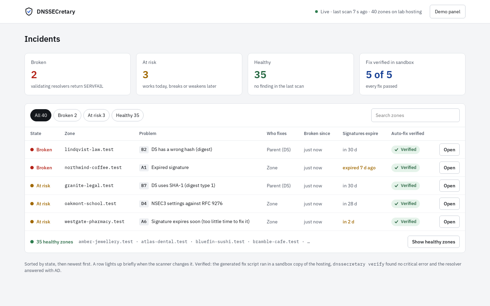
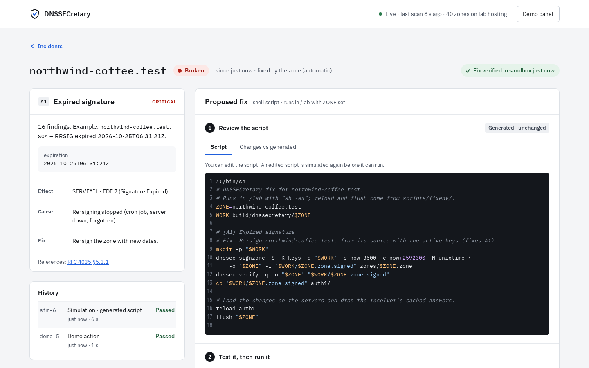
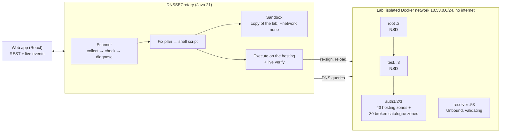

# DNSSECretary

**DNSSEC errors, found, explained and fixed before customers notice.** A web app for DNS hosting
admins, by Team Port 53.



## The problem

DNSSEC stops spoofing and cache poisoning, but one configuration mistake makes a signed domain
unreachable for every validating resolver. Plain DNS forgives errors; DNSSEC does not. Signatures
expire because re-signing stopped, the DS at the registrar doesn't match the key after a key change,
a key rollover goes too fast, an NSEC3 chain breaks. Fear of these outages keeps adoption low: only
10–15% of `.rs` domains are signed, and some owners switch DNSSEC off because it is "too
complicated". Tools like DNSViz show *what* is wrong, but the operator still has to work out *why*
and *how to fix it*.

## What DNSSECretary does

For every zone of a hosting, every 20 seconds:

1. **Detect.** Walk the chain of trust (DS → DNSKEY → RRSIG), ask every name server and a
   validating resolver, and check signature timing, algorithms, keys and NSEC/NSEC3 against the
   RFCs. 30 error types, from the team's error catalogue.
2. **Diagnose.** Turn raw findings into one diagnosis per problem, in plain language: what
   breaks, why it happened, who has to fix it (the zone, the parent/registrar, the server operator),
   with RFC references.
3. **Fix.** Generate the fix as a short shell script the admin can read and edit: re-sign, put a
   key back, publish the right DS, fix a server setting.
4. **Verify, before and after.** Run the script first in a **sandbox copy of the hosting** (a
   container without a network, all servers inside) and only call the fix "verified" if the zone
   then validates. One click runs it on the real servers, then the zone is checked live again.



## Quick start

You need Docker (with Compose v2) on Linux or WSL 2. Java and Node are optional: when they're
missing, the build runs in containers.

```sh
git clone https://github.com/tomovicj/dnssecretary.git && cd dnssecretary
sh scripts/setup.sh --check      # builds, signs, starts the lab and the web app (~1 min after the image builds)
```

Open **http://localhost:8080**. You see a hosting with 40 customer zones, three of them "at risk".
Click **Demo panel** (top right), pick a zone and an error, and click **Break this zone**: it shows up
as broken within seconds, its fix gets verified in the sandbox, and **Open → Execute on hosting**
fixes it. `sh scripts/video.sh` records the same story as a 40-second video, no clicks needed.

Step by step, and what to do when something doesn't start: [docs/getting-started.md](docs/getting-started.md).

## How it fits together



- **[`dnssecretary/`](dnssecretary/)**: the tool. Java 21, dnsjava, Javalin; a CLI (`check`,
  `fix`, `verify`, …) and the web server (`serve`).
- **[`webapp/`](webapp/)**: the front end. React + TypeScript; dashboard, zone screen, demo panel.
- **The lab**: a miniature internet in Docker with its own root and trust anchor, a validating
  resolver, the demo hosting's 40 customer zones and **one deliberately broken zone for each of
  the 30 catalogue errors**, so every check and every fix is tested against a real broken zone.
- **[`catalog/catalog.yaml`](catalog/catalog.yaml)**: the error catalogue, the single source of
  every error's title, cause, fix, symptom and RFCs, shared by the tool and the lab.

Everything stays inside the lab: no external queries, no scanning, no records changed outside it.

## Documentation

| | |
| --- | --- |
| [Getting started](docs/getting-started.md) | Requirements, setup step by step, stopping, resetting, troubleshooting |
| [Demo guide](docs/demo.md) | The 5-minute live demo, the video, what to say, a checklist for the day |
| [Using the web app](docs/web-app.md) | The dashboard, the zone screen, the demo panel, the REST API |
| [Architecture](docs/architecture.md) | Components, the scan pipeline, jobs and locks, the sandbox, design decisions |
| [Errors we detect](docs/errors.md) | All 30 catalogue errors: what breaks, how it's detected, how it's fixed |
| [How fixes work](docs/fixes.md) | Fix scripts, the sandbox, execution, verification, safety |
| [The lab](docs/lab.md) | Servers, signing, the broken zones, the demo hosting, every script |
| [Development](docs/development.md) | Building, tests, CI, adding a check or an error, conventions |
| [Limitations and next steps](docs/limitations.md) | What the demo simplifies, and the way to real hostings |

## Team Port 53

Višnja Radonjić, Marija Nikolić, Boris Ivanović, Miloš Marinković, Jovan Tomović.
