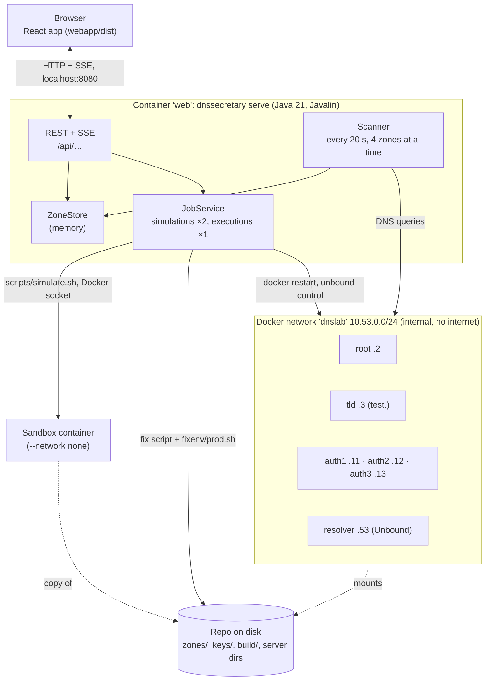
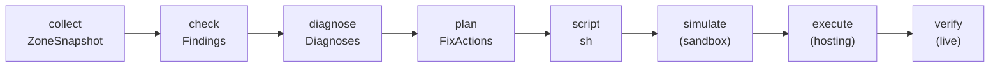

# Architecture

## Components

| Component | Where | What it does |
| --- | --- | --- |
| **Lab** | `compose.yaml`, `zones/`, `scripts/`, server dirs | NSD and Unbound servers in Docker that form a real DNS hierarchy: root → `test.` → zones. See [The lab](lab.md). |
| **DNSSECretary core** | `dnssecretary/` (Java 21) | collect → check → diagnose → plan → script. Pure checks, no I/O outside `collect`. |
| **Web server** | `dnssecretary serve`, package `web/` | Scans zones, keeps their state in memory, runs jobs, serves the API and the front end. |
| **Front end** | `webapp/` (React + TypeScript) | Dashboard, zone screen, demo panel. Talks only to `/api`. |
| **Sandbox** | `scripts/simulate.sh`, `scripts/sandbox/run.sh` | A throw-away copy of the lab without a network, to test a fix. |
| **Catalogue** | `catalog/catalog.yaml` | The 30 errors and their texts, shared by the tool and the lab scripts. |

## The pipeline for one zone

1. **Collect** (`collect/Collector`). Everything about one zone at one moment, in a `ZoneSnapshot`:
   - the delegation walk from the lab's root, validating the chain of trust down to the parent;
   - the parent's DS set, or its signed proof that there is none;
   - from **every** authoritative server separately: SOA, DNSKEY, CDS/CDNSKEY, NSEC3PARAM, sample
     queries, a name that doesn't exist and a NODATA query, and transport (UDP, TCP, EDNS size);
   - the whole signed zone file (in the lab, read from the server directory);
   - the validating resolver's view: its answers (rcode, AD, EDE) and the DNSKEY set in its cache;
   - the public keys in the key directory.

   The tool never uses the system resolver: every query names its server. That keeps it honest,
   and Docker's DNS would strip the EDE codes anyway.
2. **Check** (`check/…`). 14 checks, each a pure function `ZoneSnapshot → Findings`, with time
   from a clock in the context. That is why the unit tests run offline on recorded snapshots.
3. **Diagnose** (`diagnose/`). Findings → one diagnosis per problem, with the catalogue's severity
   and side. Rules decide between look-alikes (B1 or E2) and hide consequences (B4 hides A3).
4. **Plan and script** (`fix/`). Diagnoses → `FixAction`s → a POSIX `sh` script. See
   [How fixes work](fixes.md).
5. **Simulate, execute, verify** (`run/`, `verify/`). `SandboxRunner` runs `simulate.sh`;
   `ProdRunner` runs the script on the lab and then `LiveVerifier`. Both return PASS / FAIL / ERROR.

The same core serves the CLI (`check`, `fix`, `verify`, `snapshot`, `catalog`) and the web server.

## The web server

- **Scanner.** Every 20 seconds (`--scan-interval`), and right after every execution or demo action,
  runs collect → … → script for every watched zone, 4 at a time, into the `ZoneStore`. The watched
  zones are the demo hosting's (`zones/hosting.list`), or any list given with `--zone`.
- **ZoneStore.** The current row of every zone: status, issues, since when it's broken, the next
  signature expiry, the generated script, and the sandbox's verdict. Memory only: no database.
- **JobService.** When a zone gets a *new* fix script, it is simulated automatically (2 at a time).
  Executions and demo actions run one at a time. A read-write lock keeps them apart: scans and
  simulations read the lab, executions and demo actions write it.
- **Events.** Every change goes to the browsers over one Server-Sent Events stream (`/api/events`):
  `zone` (a row changed), `job` (a job's state), `log` (one line of a job's output). The dashboard
  never polls.
- **Static files.** `webapp/dist` with a single-page-app fallback, so `/zones/<zone>` loads the app.

The API is in [Using the web app](web-app.md#rest-api).

## Containers

| Service | Image | Network | Why |
| --- | --- | --- | --- |
| `root`, `tld`, `auth1`–`3`, `resolver`, `client` | `dnslab` (Alpine 3.20 + NSD, Unbound 1.20, BIND tools, ldns) | `dnslab`, fixed IPs | the lab |
| `signer` | `dnslab` | none | signing scripts (`keygen.sh`, `sign.sh`) |
| `app` | `dnslab-app` (+ JRE 21) | `dnslab` (dynamic IP from `.128/25`) | the CLI inside the lab network |
| `web` | `dnslab-web` (+ Docker CLI) | `dnslab` + `web` (port 8080) | the web server; needs the Docker socket for the sandbox, restarts and demo actions |
| sandbox | `dnslab-app` | none | one per simulation, deleted afterwards |
| `tour` | Playwright | `web` | records the demo video |

The `dnslab` network is `internal: true`: the lab can't reach the internet and the internet can't
reach it. The web app gets a second, normal network only to publish its port on `127.0.0.1`.

## Design decisions

- **A real DNS hierarchy, not mocks.** Every error is reproduced by a real zone on a real server,
  validated by a real resolver. If the tool says "fixed", a validating resolver agrees.
- **Fixes are shell scripts.** Readable, editable, auditable; the same text runs in the sandbox and
  on the hosting. See [How fixes work](fixes.md).
- **Verify before acting.** Nothing runs on the hosting that hasn't passed in the sandbox, unless the
  admin explicitly skips it.
- **The sandbox is the hosting, unplugged.** One container, the lab's IPs on loopback, every server as
  a process: zone files, glue and trust anchor unchanged, no network to leak into.
- **Pure checks, recorded snapshots.** Checks don't do I/O, so the 30 catalogue errors are tested
  offline, with anyone's keys, long after the lab's signatures expired.
- **One catalogue.** Titles, causes, fixes, RFCs and which errors the demo can cause live in one
  YAML file that the Java code, the shell scripts and the docs all read.
- **No database, no login.** It's a demo: state lives in memory and in the lab's files. See
  [Limitations](limitations.md).

## Security notes

- The `web` container has the **Docker socket**, which is root on the host. Fine for a demo on a
  laptop; not for production.
- The web app listens on `127.0.0.1:8080` only. It has no authentication: anyone who can reach it can
  run scripts on the lab.
- The lab's network is internal. No query leaves it; nothing outside the lab is changed.
- Keys in `keys/` are generated per machine and never committed.
