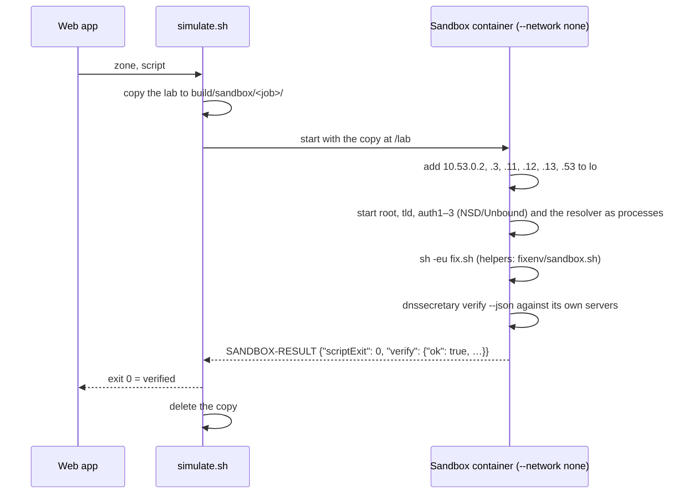

# How fixes work

A fix in DNSSECretary is a **shell script**. The tool writes it from the diagnosis, the admin can
read and edit it, and it runs the same way in three places: in a sandbox copy of the hosting (to
verify it), on the real hosting (to fix it), or nowhere (the CLI only prints it).

Why a script, and not an API call hidden inside the tool? Admins of DNS hostings work with
`dnssec-signzone`, zone files and server reloads every day. A script they can read is a fix they can
trust, change for their own setup, keep in a ticket, or run by hand.

## From diagnosis to script

`FixPlanner` turns diagnoses into a list of actions, and `ScriptGenerator` writes one block per
action, in this order:

| Action | Errors | What the script does |
| --- | --- | --- |
| `RepublishKey` | E1, E3 | moves the retired ZSK back from `keys/retired/`, so both keys sign until the caches expire |
| `KeyRollover` | C1, C3 | moves the old keys to `keys/old/`, makes new algorithm-13 keys (fast, for the lab) |
| `ResignZone` | A1–A7, B4, B5, C2, D1–D6, E4 (+ after the two above) | `dnssec-signzone -S` from the zone's source in `zones/`, `dnssec-verify`, copy to the server; NSEC3 zones stay NSEC3, with RFC 9276 parameters; A7: a copy of the source with the TTLs capped |
| `UpdateParentDs` | B1–B3, B6–B8, C2, E2 | writes the DS of the zone's active KSKs for the parent, re-signs `test.` (`sign-tld.sh`) |
| `PublishNewDs` | after `KeyRollover` | the new KSK's DS, then `sign-tld.sh` |
| `CopyToSecondary` | F1 | copies the current zone to the stale secondary (`auth2/`) |
| `ServerConfig` | F2 | `do-tcp: yes`, `max-udp-size: 1232` in the server's config (`auth3/unbound.conf`) |
| `Manual` | anything else | the catalogue's fix text, as a comment |

Every block starts with the error it fixes and the catalogue's words for it. The servers are
reloaded once, at the end. An example, for an expired zone (A1):

```sh
#!/bin/sh
# DNSSECretary fix for northwind-coffee.test.
# Runs in /lab with "sh -eu"; reload and flush come from scripts/fixenv/.
ZONE=northwind-coffee.test
WORK=build/dnssecretary/$ZONE

# [A1] Expired signature
# Fix: Re-sign northwind-coffee.test. from its source with the active keys (fixes A1)
mkdir -p "$WORK"
dnssec-signzone -S -K keys -d "$WORK" -s now-3600 -e now+2592000 -N unixtime \
    -o "$ZONE" -f "$WORK/$ZONE.zone.signed" zones/$ZONE.zone
dnssec-verify -q -o "$ZONE" "$WORK/$ZONE.zone.signed"
cp "$WORK/$ZONE.zone.signed" auth1/

# Load the changes on the servers and drop the resolver's cached answers.
reload auth1
flush "$ZONE"
```

And one at the parent (B7, a SHA-1 DS): the script writes the right DS set and re-signs the parent.

```sh
# [B7] DS uses SHA-1 (digest type 1)
# Fix: Replace the DS set of granite-legal.test. at the parent: 1 to add, 1 to remove (fixes B7)
cat > build/parent-ds/$ZONE.ds <<'EOF'
granite-legal.test.	3600	IN	DS	57275 13 2 7ACA9C4000497272D24CCCDD9D228945A5A87209F0C3631C69D7132BDA4ACD5F
EOF
sh scripts/sign-tld.sh
```

The lab controls its parent (`test.`), so it can publish the DS itself (`fix.parent.mode: lab`). With
`parent.mode: instructions` the DS is only shown, for the admin to give to the registrar.

## The script contract

- It runs with `sh -eu`: the first failing command stops it. `dnssec-verify` runs before anything is
  copied to a server, so a zone that fails to sign never reaches one.
- It runs in the lab directory, with `ZONE` set. Paths are relative, so the same script works in a
  copy of the lab.
- Before it, a **helpers file** from [`scripts/fixenv/`](../scripts/fixenv/) is sourced. It defines the
  only two things that differ between places:
  - `reload <service>`: load the changed files on that server;
  - `flush <zone>`: drop the resolver's cached answers for the zone.

| Where | Helpers | `reload` | `flush` |
| --- | --- | --- | --- |
| the sandbox | `fixenv/sandbox.sh` | restarts that server's process in the sandbox | `unbound-control` on the sandbox's resolver |
| the hosting (web app) | `fixenv/prod.sh` | `docker restart` of the lab container (found by its compose labels) | `unbound-control` in the resolver container |

Source zones in `zones/` are never changed. Some fixes change `keys/` (E1/E3, C1/C3) or a server
config (F2); `scripts/demo.sh reset` puts those back.

## Verification in the sandbox

The "Auto-fix verified" column is a real run of the script, not a guess. When a zone gets a new fix
script, the web app runs [`scripts/simulate.sh`](../scripts/simulate.sh):



The sandbox is **one container with no network** and `NET_ADMIN`. It puts the lab's own IP addresses
on its loopback interface and runs every server as a process with a generated config. Zone files,
glue records, root hints and the trust anchor therefore work unchanged: it is the same hosting,
just unplugged. One run takes about 5 seconds; two run at a time.

**Verified** means: the script exited 0, `verify` found no critical error, and the sandbox's
validating resolver answered with the AD bit.

## Execution on the hosting

**Execute on hosting** on the zone screen:

1. simulates *this exact script* in the sandbox first (unless the admin skips it, after a confirm);
2. if the simulation passes, runs it on the lab with `fixenv/prod.sh`;
3. waits a moment for the servers, then runs a **live verify** of the zone;
4. rescans the zone, so the dashboard updates.

Executions and demo actions change the lab, so they take a write lock and run one at a time. Scans and
simulations only read the lab and hold a read lock.

An edited script goes through the same steps. The editor shows whether the script is the generated
one, edited, or edited and already simulated, and a diff against the generated one.

## From the command line

```sh
sh scripts/dnssecretary.sh fix northwind-coffee.test                       # the plan and the script
sh scripts/dnssecretary.sh fix northwind-coffee.test --script > build/fix.sh
sh scripts/simulate.sh northwind-coffee.test build/fix.sh                  # exit 0 = verified
sh scripts/dnssecretary.sh verify northwind-coffee.test                    # live
```

## Limits

- The sandbox resolver starts with an empty cache. For E1/E3 a simulation proves that the fixed
  zone validates, not how caches that still hold the old key behave. On the hosting it works,
  because both keys sign until the caches expire.
- `KeyRollover` is fast, for the lab: a real algorithm rollover publishes keys and waits for TTLs at
  each step. The catalogue's recipe lists those steps.
- See [Limitations and next steps](limitations.md) for the rest.
