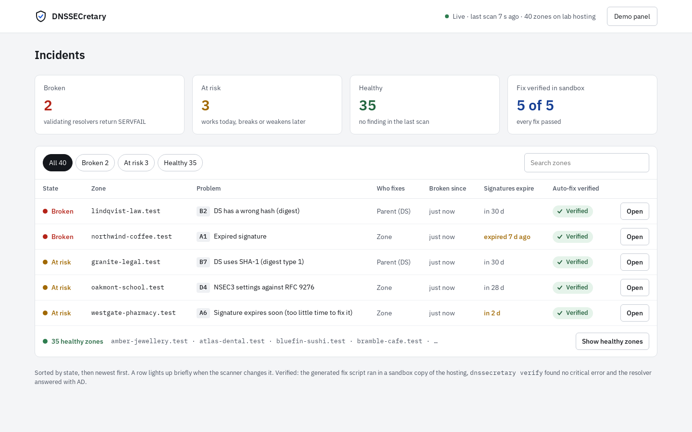
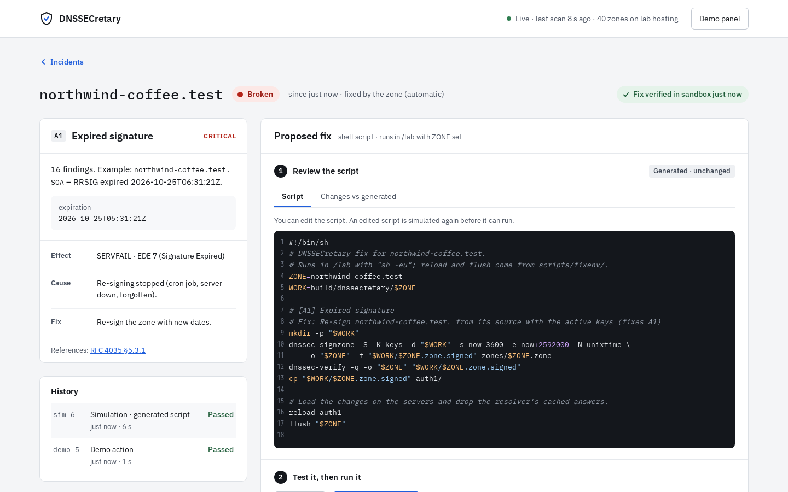
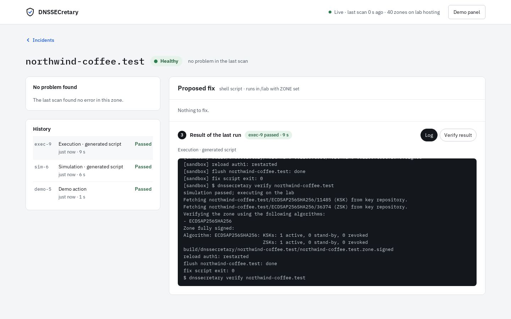
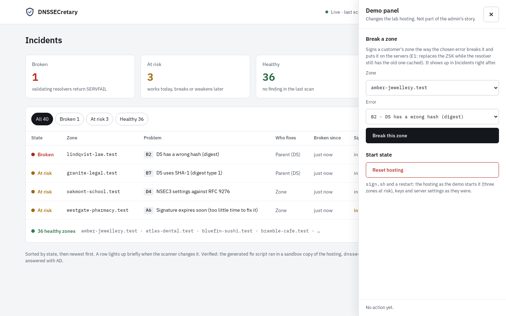

# Using the web app

`sh scripts/web.sh` (or `scripts/setup.sh`) starts it on **http://localhost:8080**. It updates live:
there is nothing to refresh.

## The dashboard: Incidents



- **The header** shows whether the live connection is up, when the last scan ran, and how many
  zones are watched. **Demo panel** (top right) changes the lab for the demo, see below.
- **The counters**: zones that are *Broken* (validating resolvers return SERVFAIL), *At risk* (they
  work today but will break or are unsafe), *Healthy*, and how many of the fixes were verified in
  the sandbox.
- **The list** shows broken zones first, then the ones at risk, newest problem first. Healthy zones
  are folded into one line (**Show healthy zones**). Filter by state or search by name.
- **Each row**: the state, the zone, the first problem (catalogue ID + title, `+N` if there are
  more), who has to fix it (*Zone*, *Parent (DS)*, *Operator*), how long it has been broken, when
  its signatures expire (in orange within 7 days), and the **Auto-fix verified** badge:

  | Badge | Meaning |
  | --- | --- |
  | Verified | the generated fix script ran in a sandbox copy of the hosting, and the zone validated afterwards |
  | Simulating | that run is going on now |
  | Failed | the script ran but the zone still has a critical error, or the script stopped; open the zone and look at the log |
  | No script yet | nothing to fix automatically: the fix is manual (the zone screen says what to do) |

A row lights up briefly when the scanner changes it.

## The zone screen



- **The header**: the zone, its state, since when, who fixes it, and the sandbox's verdict on the fix.
- **The diagnosis card** for each problem: the catalogue ID and title, severity, how many findings
  and an example (with the raw facts, e.g. the expiration time), then *Effect* (what resolvers do,
  with the EDE code), *Cause* and *Fix* in plain language, and links to the RFCs.
- **History**: every simulation, execution and demo action for this zone, newest first.
- **Proposed fix**, in three steps:
  1. **Review the script.** The generated shell script in an editor. Edit it if you need to; the badge
     says whether it is *Generated · unchanged*, *Edited · not simulated yet* or *Edited ·
     simulated*. **Changes vs generated** shows a diff, **Reset to generated** undoes your edits.
  2. **Test it, then run it.** **Simulate** runs this exact script in the sandbox. **Execute on
     hosting** simulates it first and runs it on the hosting only if that passes; *Skip the
     simulation* (asks to confirm) runs it directly.
  3. **Result of the last run**: the job, its state and duration, the live **Log**, and the **Verify
     result** (which checks still fail, and the resolver's answers with AD).

When the fix has run, the zone turns **Healthy** and the dashboard follows:



## The demo panel



Not part of the admin's story: it changes the lab so there is something to show.

- **Break a zone**: pick a hosting zone and one of 18 catalogue errors. The zone is signed the way
  that error breaks it and put on the servers (E1: the ZSK is replaced while the resolver still has
  the old one cached). It shows up in Incidents right after.
- **Reset hosting**: `sign.sh` and a restart. The hosting as the demo starts it (three zones at
  risk), keys and server settings as they were. About 10 seconds.

The same from a terminal: `sh scripts/demo.sh break <zone> <error>`, `sh scripts/demo.sh reset`.
See the [Demo guide](demo.md).

## REST API

Everything the front end does goes through this API, so it can be scripted too. JSON in and out;
zone names in paths without the trailing dot. The shapes are the records in
[`web/Api.java`](../dnssecretary/src/main/java/rs/port53/dnssecretary/web/Api.java) and
[`webapp/src/api/types.ts`](../webapp/src/api/types.ts). Errors are `{"error": "…"}` with 400 or 404.

| Method | Path | |
| --- | --- | --- |
| GET | `/api/zones` | a row for every zone: status, issues, `brokenSince`, `nextExpiry`, `verified`; broken first |
| GET | `/api/zones/{zone}` | the row + the full report (as `check --json`) + the script (`generated`, `lastSimulated`) + the zone's jobs |
| POST | `/api/zones/{zone}/simulations` | `{"script": "…"}` (default: the generated one) → a job, 202 |
| POST | `/api/zones/{zone}/executions` | `{"script": "…", "simulateFirst": true}` → a job, 202 |
| GET | `/api/jobs`, `/api/jobs/{id}` | jobs, newest first; one job with its log and verify result |
| GET | `/api/catalog` | the 30 catalogue entries (title, cause, fix, symptom, EDE, RFCs, …) |
| POST | `/api/scan` | scan every zone now |
| GET | `/api/events` | Server-Sent Events (`Accept: text/event-stream`): `zone`, `job`, `log` |
| GET | `/api/demo/scenarios` | the errors the demo can put on a hosting zone (`{id, title}`) |
| POST | `/api/demo/break` | `{"zone": "…", "error": "A1"}` → a job (kind `DEMO`), 202 |
| POST | `/api/demo/reset` | → a job (kind `DEMO`), 202 |

Jobs are `sim-N` (simulation), `exec-N` (execution) and `demo-N`; their state goes QUEUED → RUNNING →
PASS / FAIL / ERROR.

```sh
curl -s localhost:8080/api/zones | jq '.[] | select(.status != "OK") | {zone, status, issues: [.issues[].id]}'
curl -s -X POST localhost:8080/api/demo/break -H 'Content-Type: application/json' \
     -d '{"zone": "northwind-coffee.test", "error": "A1"}'
curl -s -N -H 'Accept: text/event-stream' localhost:8080/api/events      # watch the live events
```

## Without a backend

For front-end work, `cd webapp && npm run mock` serves the app with a fake backend
([`src/api/mock.ts`](../webapp/src/api/mock.ts)): the same 40 zones, a few incidents, jobs that finish
after a moment. A script that contains `BAD` fails in its sandbox. The front-end tests use it too.
